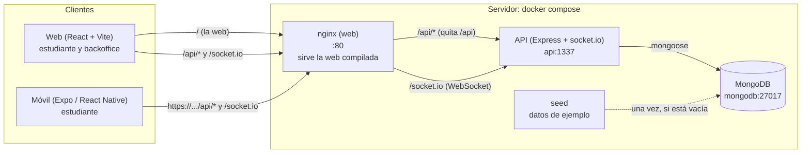

# Studate: despliegue

El `docker compose` que levanta [Studate](https://studateapp.blogspot.com/) entero, en local o en el
servidor: la base de datos, la API y la web. Es el proyecto del Grupo 3 de EA (María Cazorla, Diego
Soledispa y Miguel Ángel Quiroga).

Este repositorio no tiene código de aplicación: solo compone las imágenes que publican los otros dos,
como en el Seminario 10.

| Servicio | Imagen | Qué es |
|---|---|---|
| `mongodb` | `mongo:8` | La base de datos. En un volumen y **sin puerto público** |
| `api` | `ghcr.io/mariacazorla/stududate---backend` | La API de Express ([STUDUDATE---BACKEND](https://github.com/mariacazorla/STUDUDATE---BACKEND)). Sin puerto público |
| `web` | `ghcr.io/mariacazorla/studate---frontend` | nginx con la web compilada ([STUDATE---FRONTEND](https://github.com/mariacazorla/STUDATE---FRONTEND)). **El único abierto**: sirve la web y reenvía `/api` y `/socket.io` a la API |
| `seed` | la de la API | Llena la base de datos con los datos de ejemplo si está vacía, y termina |

```
navegador ──> :80 nginx (web) ──┬── /            la web (React)
                                ├── /api/        ──> api:1337 (Express)  ──> mongodb:27017
                                └── /socket.io/  ──> api:1337 (chat)
```

Desde fuera solo se ve nginx. La API y MongoDB solo existen dentro de la red de Docker `studate-net`, y
se llaman por su nombre de servicio. Al salir todo por el mismo origen no hay CORS, y la URL de la API
que lleva la web compilada es simplemente `/api`: la misma imagen sirve para cualquier servidor.

## Arquitectura

Studate son dos frontends (la web en React, con la app del estudiante y el backoffice, y la app del
móvil en Expo) que hablan con una sola API (Express) por HTTP y por socket.io, y la API con MongoDB.
Lo que no se pinta (modelos, cliente HTTP con JWT, servicios y el socket) está una sola vez en
`packages/shared` del frontend y lo usan la web y el móvil.



El camino de una petición, con JWT:

1. **Entrar.** `POST /api/auth/login` con el correo y la contraseña. La API comprueba la contraseña (scrypt)
   y responde con un **access token** (JWT firmado con `JWT_SECRET`, dura 15 minutos; lleva el id y el rol)
   y un **refresh token** (JWT con otro secreto, dura 7 días). En la web el refresh token va en una cookie
   `HttpOnly` con `Path=/api/auth`, así que JavaScript no lo ve; la app del móvil manda `X-Client: movil`
   y lo recibe en el JSON, y lo guarda en el almacén cifrado del teléfono.
2. **Cada petición** lleva `Authorization: Bearer <access token>`. nginx reenvía `/api/*` a la API quitando
   el prefijo; el middleware `VerifyToken` comprueba la firma y la caducidad, y que el usuario siga activo
   en MongoDB; `RequireRole` comprueba el rol (403 si no toca); Joi valida el body (422); y el controlador
   llama al servicio, que lee o escribe en MongoDB con Mongoose.
3. **Cuando el access token caduca**, la API responde 401 y el cliente compartido pide uno nuevo con
   `POST /api/auth/refresh` (la cookie o el body) y repite la petición una sola vez. Si tampoco vale, se
   cierra la sesión.
4. **El chat** no pasa por HTTP: el cliente abre socket.io contra el origen (nginx reenvía `/socket.io` a
   la API con las cabeceras de WebSocket) mandando el access token en el handshake; `VerifySocketToken` lo
   comprueba igual que `VerifyToken`, y sin token válido no hay conexión. Cada Date es una sala en la que
   solo entran sus dos usuarios; un mensaje se guarda en MongoDB y se emite a la sala, y los cambios de un
   Date (primer mensaje, caducidad, prórroga, bloqueo) llegan como `date:updated`. Los admin entran además
   en la sala `admins` y reciben las alertas del botón de ayuda al momento.
5. **Las tareas del servidor**: la API cierra cada minuto los Dates pendientes caducados y avisa a su sala.

## Detrás del proxy de la UPC

En el servidor de la asignatura el HTTPS **no lo hace nuestro nginx**: lo termina el proxy inverso de la
UPC (`proxyeetac.upc.edu`), que recibe `https://ea3.upc.edu` y reenvía por http a un puerto de nuestra
máquina. Por eso ahí se despliega **por http** (`docker compose up -d`, sin `compose.https.yml` ni
certificados) y con estas tres cosas en el `.env`:

| Variable | Valor | Por qué |
|---|---|---|
| `WEB_PORT` | el puerto de la máquina al que reenvía el proxy | es lo único que ve el proxy |
| `CORS_ORIGINS` | `https://ea3.upc.edu` | la dirección pública es la del proxy, con https |
| `COOKIE_SECURE` | `true` | el navegador habla con el proxy por https: la cookie del refresh token puede (y debe) ir `Secure` |

La app del móvil apunta a `https://ea3.upc.edu/api`. Una vez dentro, el resto del guion es el de
"Despliegue en el servidor, paso a paso". Si el proxy reenviara varios dominios (`ea3-api.upc.edu`,
`ea3-back.upc.edu`) al mismo puerto, todos sirven la misma web: la API responde en `/api` y el backoffice
en `/admin` en cualquiera de ellos.

### Estado: desplegado en ea3 (25-11-2026)

Studate está en marcha en `https://ea3.upc.edu`. El proxy de la UPC reenvía al puerto **80** de la máquina
`ea3` (`10.4.120.118` con la VPN; usuario `ea`), donde este repo está clonado en `/home/ea/STUDATE---DOCKER`
en la rama `main`, con su `.env` (`WEB_PORT=80`, `CORS_ORIGINS=https://ea3.upc.edu`, `COOKIE_SECURE=true`,
`IMAGE_TAG=latest` y dos secretos generados con `openssl rand -hex 32`, que solo existen en ese fichero).
Comprobado desde fuera: login, la sesión se mantiene al recargar por https, el chat, el backoffice, y el
27017 cerrado. Para actualizar: `docker compose pull && docker compose up -d`.

Dos cosas que salieron en ese primer despliegue:

- **El proxy no deja pasar WebSocket**: responde 400 a la subida de protocolo, así que socket.io se queda en
  HTTP long-polling. El chat funciona igual (los mensajes llegan en menos de un segundo); solo cambia que
  hay una petición cada pocos segundos en vez de una conexión abierta, y en la consola del navegador sale
  un aviso por el intento de subida. Por la IP con la VPN sí va por WebSocket.
- **nginx se quedaba con la IP vieja de la API**: al cambiar el `.env` y hacer `up -d`, Compose recreó la
  API con otra IP interna y nginx, que había resuelto `api` al arrancar, daba 502 en `/api`. El arreglo
  inmediato fue `docker compose restart web`; el definitivo está en la imagen de la web (nginx resuelve
  `api` con el DNS de Docker cada 10 s). Con una imagen anterior a ese cambio, tras recrear la API hay que
  reiniciar la web.

## Cómo arrancarlo

Hace falta Docker con Compose (en el servidor, Docker Engine; en Windows o Mac, Docker Desktop).

```
cp .env.example .env     # y cambia los dos secretos de los JWT y CORS_ORIGINS
docker compose up -d
```

El compose **no arranca** si faltan `JWT_SECRET`, `JWT_REFRESH_SECRET` o `CORS_ORIGINS` en el `.env`: es a
propósito, para no dejar una API con un secreto de mentira.

Después, Studate está en `http://<dirección del servidor>` (o en el puerto de `WEB_PORT`). La primera
vez, el servicio `seed` deja los datos de ejemplo; los usuarios y sus contraseñas están en el README del
backend (todos con `studate26`; `admin@example.com` para el backoffice y `laia@example.com` como estudiante).

Para ver qué pasa:

```
docker compose ps               # estado de los contenedores
docker compose logs -f api      # los logs de la API (o web, mongodb, seed)
docker compose down             # parar (los datos se quedan en el volumen)
docker compose down -v          # parar y borrar los datos
```

## Con las imágenes de ghcr.io o construidas aquí

Las imágenes las publica GitHub Actions en cada push: `:latest` desde `main` y `:develop` desde
`develop`. Con `IMAGE_TAG` en el `.env` se elige cuál se despliega. Los paquetes de ghcr.io nacen
privados: para que el servidor pueda bajarlos hay que ponerlos públicos una vez (en GitHub, Packages >
el paquete > Package settings > Change visibility), o hacer antes `docker login ghcr.io`.

Para construir las imágenes a partir del código (para probar en local lo que todavía no está subido, o
si el servidor no puede bajar de ghcr.io), se añade `compose.build.yml`, que supone los tres
repositorios clonados uno al lado del otro:

```
docker compose -f docker-compose.yml -f compose.build.yml up -d --build
```

## Qué se cambia en el .env

| Variable | Qué es | Por defecto |
|---|---|---|
| `MONGO_DB` | Nombre de la base de datos | `studate` |
| `WEB_PORT`, `WEB_PORT_HTTPS` | Puertos del servidor en los que escucha nginx (el segundo, solo con `compose.https.yml`) | `80`, `443` |
| `CORS_ORIGINS` | Dirección pública de Studate (varias, separadas por comas). **Obligatoria** | |
| `COOKIE_SECURE` | `true` solo con HTTPS. Con http tiene que ser `false` o nadie podrá mantener la sesión | `false` |
| `JWT_SECRET`, `JWT_REFRESH_SECRET` | Secretos de los tokens, distintos entre sí. **Obligatorios** | |
| `JWT_EXPIRES_IN`, `JWT_REFRESH_EXPIRES_IN` | Cuánto dura cada token | `15m`, `7d` |
| `IMAGE_TAG` | Qué imagen se despliega: `latest` (main) o `develop` | `latest` |

La API lee su configuración al arrancar, así que para cambiar algo del `.env` basta con volver a hacer
`docker compose up -d`: Compose recrea el contenedor con los valores nuevos, sin construir nada. La web
no tiene nada que configurar: la URL de la API es `/api` y la resuelve nginx.

## Actualizar el servidor

Cuando hay una versión nueva en `main` (o en `develop`, según `IMAGE_TAG`):

```
docker compose pull
docker compose up -d
```

Compose baja las imágenes nuevas y recrea solo los contenedores que han cambiado. La base de datos no
se toca: está en el volumen `mongo-data`.

## HTTPS

El HTTPS lo termina el mismo nginx de la web, sin cambiar la imagen: `compose.https.yml` monta encima
un server en el 443 con el certificado (`nginx/https.conf`) y deja el 80 solo para redirigir a https.
Las reglas de la web (rutas de la SPA, `/api`, `/socket.io`) son las mismas, porque van en un fichero
aparte dentro de la imagen (`studate-app.conf`) que incluyen los dos servers.

1. El certificado y su clave van en `certs/studate.crt` y `certs/studate.key`. La carpeta no se sube a
   git. Hay dos casos:
   - **Solo IP (sin dominio):** un certificado autofirmado. El navegador avisa la primera vez y hay que
     aceptarlo; la app del móvil con Expo Go no lo acepta.
     ```
     openssl req -x509 -newkey rsa:2048 -nodes -days 365 \
       -keyout certs/studate.key -out certs/studate.crt \
       -subj "/CN=studate" -addext "subjectAltName=IP:<ip del servidor>"
     ```
   - **Con dominio:** un certificado de Let's Encrypt (`certbot certonly --standalone -d <dominio>`, con el
     80 libre un momento) y se copian `fullchain.pem` y `privkey.pem` a `certs/` con esos dos nombres.
2. En el `.env`: `COOKIE_SECURE=true` y `CORS_ORIGINS=https://<dirección>`.
3. Levantar con los dos ficheros:
   ```
   docker compose -f docker-compose.yml -f compose.https.yml up -d
   ```

Comprobación: `curl -k https://<dirección>/api/ping` responde, `curl -I http://<dirección>/` da 301 a https,
y la cookie del login lleva `Secure`.

## Despliegue en el servidor, paso a paso

Lo que hay que hacer el día que se entre en el servidor por primera vez. Hace falta un usuario con
`sudo` y acceso por SSH (con clave: `ssh-copy-id usuario@<ip>` desde el ordenador, una sola vez).

1. **Docker.** Si no está: `curl -fsSL https://get.docker.com | sudo sh`, y `sudo usermod -aG docker $USER`
   (hay que salir y volver a entrar). Comprobar: `docker compose version`.
2. **Puertos.** `sudo ss -ltnp | grep -E ':80|:443'`: tienen que estar libres. Si otro grupo usa el mismo
   servidor, se cambian `WEB_PORT` y `WEB_PORT_HTTPS` en el `.env`.
3. **Este repo.** `git clone https://github.com/mariacazorla/STUDATE---DOCKER.git && cd STUDATE---DOCKER`.
4. **Configuración.** `cp .env.example .env` y editar: los dos secretos (generados con el comando del
   fichero), `CORS_ORIGINS` con la dirección pública y `COOKIE_SECURE` (`false` por http, `true` por https).
5. **Imágenes.** Los paquetes de ghcr.io tienen que ser públicos (o `docker login ghcr.io` antes).
   `docker compose pull` baja la API y la web; MongoDB se baja sola.
6. **Arrancar.** Por http: `docker compose up -d`. Por https: el apartado anterior.
7. **Comprobar desde el propio servidor:** `docker compose ps` (api, web y mongodb en `Up`, seed en
   `Exited (0)`), `docker compose logs seed` (los datos creados) y `curl http://localhost/api/ping`.
8. **Comprobar desde fuera** (desde un ordenador con la VPN, si hace falta): abrir la dirección en el
   navegador, entrar con `laia@example.com` / `studate26`, recargar en `/dates` (no da 404 y la sesión
   sigue) y entrar como `admin@example.com` en el backoffice. Con curl:
   ```
   curl -c c.txt -X POST http://<dirección>/api/auth/login -H "Content-Type: application/json" -d '{"email":"laia@example.com","password":"studate26"}'
   curl -b c.txt -X POST http://<dirección>/api/auth/refresh
   ```
9. **Comprobar que MongoDB no está expuesto:** desde fuera, `nc -zv <ip> 27017` tiene que fallar.

Para actualizar después: `docker compose pull && docker compose up -d` (apartado anterior). Si algo
falla: `docker compose logs -f api` suele decir qué (casi siempre, una variable del `.env`).
